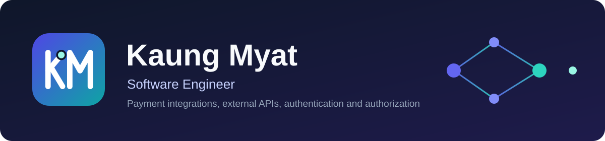

  

  
  
  
  
  <!--  -->

## Hi 👋, I'm Kaung Myat

I'm a software engineer who builds reliable services and the integrations around them. I work on payment APIs, third-party API connections, and authentication and authorization, and I care about shipping things that are efficient, secure, and easy for a team to maintain.

## What I work on

- **Payment API integration:** checkout flows, callbacks, and reconciliation
- **External API integration:** connecting services with clear contracts and sensible error handling
- **Authentication and authorization:** login flows, tokens, roles, and permissions
- **Microservices:** service-to-service communication with gRPC, event-driven messaging with Kafka, and MQTT-based messaging, using Docker and CI/CD pipelines for deployment.

## Tech stack

**Languages and frameworks**

  
  
  
  
  
  
  

**Databases**

  
  
  

**Microservices and cloud**

  
  
  
  
  
  
  

## GitHub stats

  
  

<!-- Optional: pin your best repos with short descriptions using the "Customize your pins" option on your profile. -->
